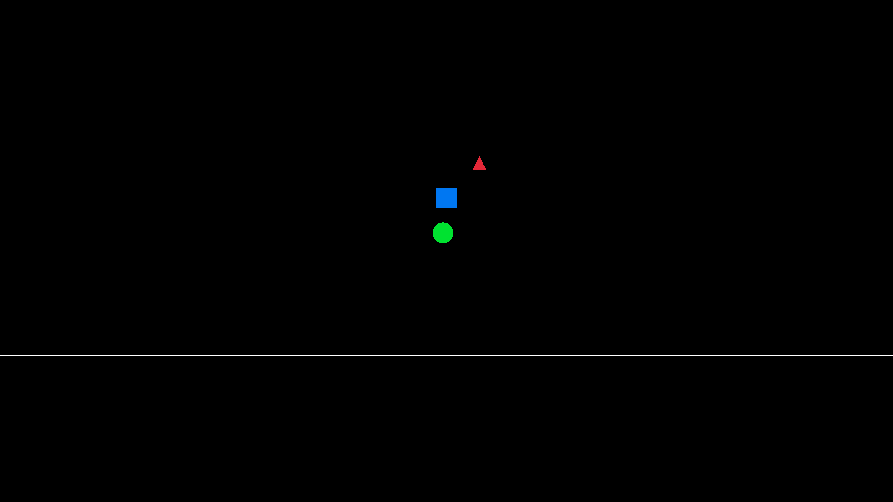
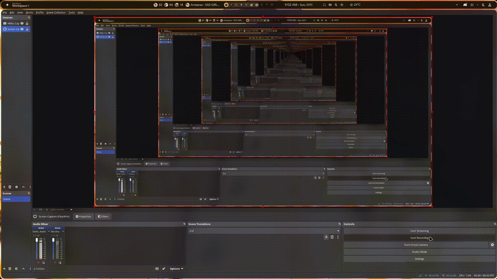

# ChudPhysics

A 2D physics engine written completely from scratch in Rust. No external physics libraries, just raw math and logic.

## Description
* **Custom Math Library:** Hand-rolled `Vec2`, `Vec3`, `Vec4`, `Mat2`, `Mat3`, and `Mat4`.
* **Fixed Timestep:** A stable game loop that prevents lag spikes from breaking the simulation.
* **Dynamics:** Gravity, mass, impulse resolution, and friction.
* **Collisions:** Swept AABB (Box vs Box), Circle vs Circle, and Circle vs Box.
* **Visual Debugging:** Renders shapes in real-time using `macroquad` so you can see the math in action.
* **Lightwight:** Lightwight 2d physcis engine


## Demo



## Getting Started
- Uses macroquad for visual
- Very lightwight
- Can run on window and linux (Tested only in Linux for now)

## Dependencies
- Need just rust compiler and cargo other things will get install automatically
- And if ur using binary then just computer

## Installing
- Just download the bin file or clone the repo and run command ```cargo run --bin visual```

## How to Run
To run the visual physics simulation:
```bash
cargo run --bin visual

```
## Help
if ur using already compiled bin then just visual one.
```
 ./visual
```
